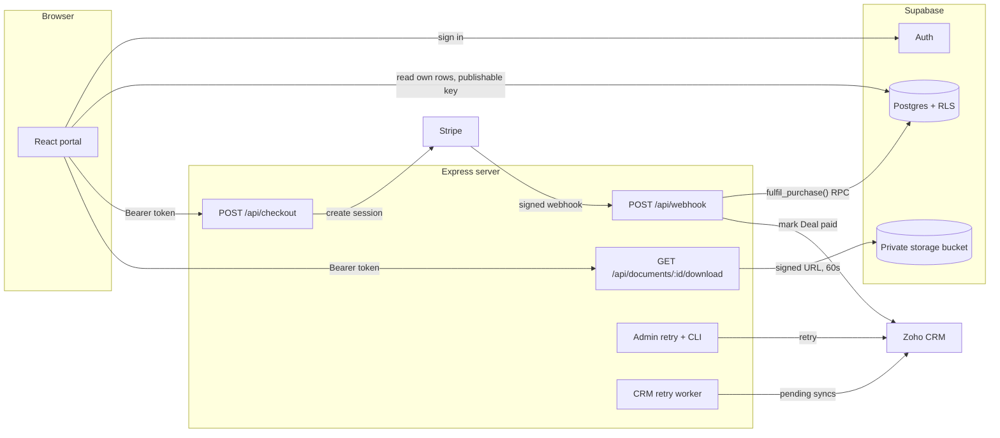
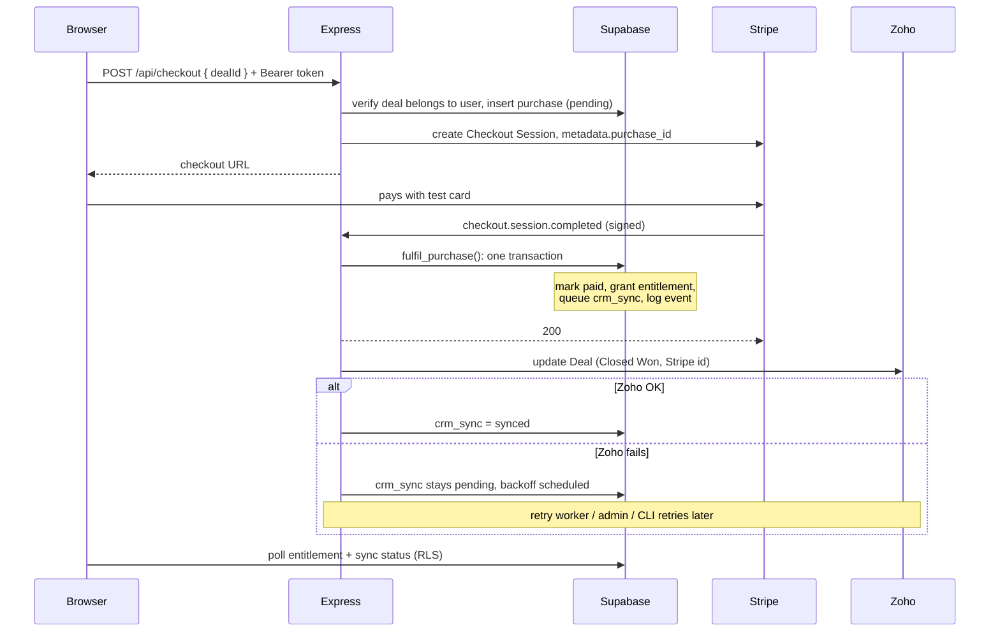

# Paid Client Access

A small client portal where a signed-in client pays for a document with Stripe, gets access in Supabase, and has the matching **Zoho CRM Deal** marked as paid.

- **Server:** Node.js + Express 5 + TypeScript (`server/`)
- **Web:** React + Vite + TypeScript (`web/`)
- **Data / auth / files:** Supabase Postgres, Auth, and Storage (`supabase/`)
- **Payments:** Stripe Checkout (test mode only)
- **CRM:** Zoho CRM REST API v7, OAuth 2.0 refresh-token flow (India data centre)

---

## What works

| Requirement | Status |
|---|---|
| Logged-in client pays with Stripe test checkout | ✅ Hosted Checkout, price taken from the database |
| Webhook verifies the signature and grants access | ✅ `stripe.webhooks.constructEvent` on the raw body |
| Repeated webhook does not create a second entitlement or Zoho update | ✅ Event log + row lock + state machine + unique constraints |
| Zoho Deal marked paid (Stage `Closed Won`, Stripe payment id written) | ✅ |
| Zoho failure does not block access; sync stays pending and is retryable | ✅ Background worker with exponential backoff, plus admin endpoint and CLI |
| Portal shows access and CRM sync status, read from Supabase | ✅ Reads go directly to Supabase under RLS |
| One client cannot read another client's document or purchase | ✅ RLS on every table, private bucket, server-side entitlement check |
| No credentials in the repo | ✅ `.env.example` only; server refuses to boot with live Stripe keys |

---

## Architecture



**Who holds what:**

- **Browser:** only the Supabase URL, the publishable key, and the user's own session token. It can **read** its own rows and nothing else. There are no insert, update, or delete RLS policies anywhere, so a modified frontend cannot grant itself access.
- **Express:** the Stripe secret key, the webhook secret, the Supabase secret key, and the Zoho OAuth credentials. Every write goes through here.

### Purchase flow



---

## Key design decisions

### 1. Stable IDs, never email matching

Before redirecting to Stripe, the server creates a `purchases` row and puts its UUID in the session metadata (`purchase_id`). The webhook uses that pointer to load everything else — client, document, Zoho Deal id — **from our own database**. Stripe carries only a reference, so a typo'd or shared email can never mark the wrong client as paid.

The `deals` table maps *client + document → Zoho Deal id*. Zoho ids are 19 digits, above JavaScript's safe-integer limit, so they are stored as `text` everywhere.

### 2. Idempotency in layers

`fulfil_purchase` is a Postgres function that the webhook calls through RPC. Inside **one transaction** it:

1. **Locks the purchase row** (`select … for update`), so concurrent deliveries of the same payment queue up instead of racing.
2. **Checks session id, amount, and currency** against what we stored at checkout.
3. **Only acts on the `pending`/`expired` → `paid` transition.** Every later call is a no-op that still returns the current state.
4. **Grants the entitlement and queues the CRM sync.** Unique constraints — `entitlements (client_id, document_id)` and the `crm_syncs` primary key — physically prevent duplicates even if the logic above had a bug.
5. **Records the Stripe event as processed in the same transaction.** If the server crashes halfway, the event row rolls back with the work, so Stripe's retry processes it properly. "Processed" is never recorded without the work it describes.

The function is `revoke`d from `anon` and `authenticated` (otherwise anyone with the publishable key could call it through the REST API) and uses `set search_path = ''`.

### 3. Access is never blocked by the CRM

The webhook commits the entitlement, **replies 200 to Stripe, then calls Zoho**. A slow or failing CRM therefore cannot cause Stripe timeouts and redeliveries. If Zoho fails, the `crm_syncs` row stays `pending` with `attempts`, `last_error`, and `next_attempt_at`.

Three ways to retry, all through the same function:

- **Background worker** polls every 15s. Exponential backoff with jitter (30s → 1h cap), 8 attempts, then `failed`.
- **Admin endpoint** `POST /api/admin/crm-syncs/:purchaseId/retry` with an `x-admin-key` header.
- **CLI** `npm run retry-crm` (all due rows) or `npm run retry-crm -- <purchaseId>` (one row, also revives `failed`).

Each attempt first claims a **lease** with a single conditional `UPDATE … WHERE status = 'pending' AND next_attempt_at <= now()`, so the webhook, the worker, the CLI, and multiple server instances can never sync the same Deal at the same time.

Errors are classified: network errors, timeouts, 429, and 5xx are **retriable**; a record-level rejection (Deal deleted, invalid field) is **permanent** and goes straight to `failed` instead of retrying 8 times.

The Zoho update itself is idempotent: it sets fixed values, so repeating it is harmless.

### 4. Zoho OAuth

- Self Client with least-privilege scopes: `ZohoCRM.modules.deals.ALL,ZohoCRM.modules.contacts.READ`.
- The refresh token stays on the server. Access tokens (about 1 hour) are cached and **refreshed 5 minutes early**. Concurrent callers share one in-flight refresh. A `401` clears the cache and retries once.
- Handles Zoho's quirk of answering bad credentials with HTTP **200** plus an `error` field.
- Data centre is configuration (`ZOHO_ACCOUNTS_URL`, `ZOHO_API_DOMAIN`), not hardcoded. This project uses `.in`.

### 5. Client isolation

- **RLS on every table**, SELECT-only, `client_id = (select auth.uid())`. `stripe_events` has RLS enabled and no policies, so it is server-only.
- **Column privileges** on `crm_syncs`: clients can see `status` and `synced_at`, but not internal `last_error` text. RLS limits rows; grants limit columns.
- **Documents live in a private bucket with no storage policies.** The download route checks the entitlement, then returns a **60-second signed URL**. One access check, in one place, and every download is logged.
- The checkout route takes only a `dealId` and filters by the user id from the **verified token**. Client B sending Client A's deal id gets the same 404 as a nonexistent deal.

### 6. Double-payment protection

- The checkout route refuses if the client already has an active entitlement (`409 already_owned`).
- An existing open Stripe session is **reused** (the button shows "Resume checkout").
- A **partial unique index** allows only one `pending` purchase per deal, catching simultaneous clicks.
- Session creation uses a Stripe **idempotency key** per purchase.
- A retired `expired` purchase can still become `paid`, so a payment that lands at the exact moment a session is retired is honoured, not lost.

### 7. Webhook responses

| Situation | Response | Why |
|---|---|---|
| Bad or missing signature | `400` | Not from Stripe |
| Transient failure (DB unreachable) | `500` | Stripe redelivers, which is what we want |
| Unmatchable payment (unknown purchase, amount mismatch) | `200` + error log | Retrying for 3 days cannot fix it; grant nothing and flag for manual review |
| Already processed | `200` `{ duplicate: true }` | Idempotent |

---

## Project layout

```
paid-client-access/
├── server/
│   └── src/
│       ├── config/env.ts          zod-validated env, refuses live Stripe keys
│       ├── lib/                   Stripe + Supabase clients, pino logger, errors
│       ├── middleware/            Bearer-token auth, admin key (constant-time compare)
│       ├── integrations/zoho.ts   OAuth token cache + Deal update
│       ├── services/crmSync.ts    lease, backoff, retry logic
│       ├── routes/                checkout, webhook, documents, admin
│       ├── workers/               CRM retry worker
│       ├── scripts/retry-crm.ts   manual retry command
│       └── types/                 generated database types
├── web/
│   └── src/
│       ├── lib/                   env guard, Supabase client, API client
│       ├── hooks/                 session, portal data
│       └── components/            login, portal, deal card
└── supabase/
    ├── migrations/                schema, RLS, fulfil_purchase, storage, constraints
    └── seed.sql                   2 clients, 1 document, 2 deals
```

---

## Local setup

### Prerequisites

- Node.js **22.12+** (`nvm use` reads `.nvmrc`)
- [Stripe CLI](https://docs.stripe.com/stripe-cli) (`brew install stripe/stripe-cli/stripe`)
- A Supabase project, a Stripe account in test mode, and a Zoho CRM Developer Edition account
- `jq` is useful for the test commands (`brew install jq`)

### 1. Install

```bash
git clone <repo-url> && cd paid-client-access
nvm use
cd server && npm install && cd ..
cd web && npm install && cd ..
```

### 2. Supabase

1. Create a project and note the **Project URL**, **publishable key**, and **secret key** (Project Settings → API Keys).
2. Create two users under **Authentication → Users → Add user**, with **Auto Confirm User** ticked:
   - `client-a@test.com`
   - `client-b@test.com`
3. Link the CLI and apply the migrations:
   ```bash
   npx supabase login
   npx supabase link --project-ref <project-ref>
   npx supabase db push --remote
   ```
4. Edit `supabase/seed.sql`: replace the two user UUIDs with the ones from step 2, and the Zoho Contact and Deal ids with yours (step 4 below). Then run it in the dashboard **SQL Editor**.
5. Upload any PDF named **`sample-document.pdf`** to the **`documents`** bucket (Storage).

### 3. Stripe

1. Use a Stripe account in **test mode / sandbox** and copy the secret key (`sk_test_…`).
   > New Stripe accounts in India are invite-only, so this project uses a US-region sandbox. Test mode needs no account activation.
2. Log in the CLI and start forwarding webhooks. Leave this running:
   ```bash
   stripe login
   stripe listen --forward-to localhost:4000/api/webhook \
     --events checkout.session.completed,checkout.session.async_payment_succeeded,checkout.session.async_payment_failed,checkout.session.expired,charge.refunded
   ```
3. Copy the printed `whsec_…` into `STRIPE_WEBHOOK_SECRET`.

No Stripe Products are needed. The price comes from `documents.price_minor`, so the database is the single source of truth.

### 4. Zoho CRM

1. In Zoho CRM, create 2 Contacts and 2 Deals (one per client). Note the record ids from each URL.
2. Add a **Single Line** custom field `Stripe Payment ID` to Deals. Its API name should be `Stripe_Payment_ID`.
3. At [api-console.zoho.in](https://api-console.zoho.in), create a **Self Client**. Generate a grant code with scope `ZohoCRM.modules.deals.ALL,ZohoCRM.modules.contacts.READ`, then exchange it for a refresh token:
   ```bash
   curl -X POST "https://accounts.zoho.in/oauth/v2/token" \
     -d grant_type=authorization_code \
     -d client_id=<client_id> -d client_secret=<client_secret> -d code=<grant_code>
   ```
   Use `.com` / `.eu` domains instead if your Zoho account is in another data centre.

### 5. Environment variables

```bash
cp server/.env.example server/.env
cp web/.env.example web/.env
```

**`server/.env`**

| Variable | Description |
|---|---|
| `PORT` | Default `4000` |
| `WEB_ORIGIN` | `http://localhost:5173`, used for CORS and Stripe redirect URLs |
| `SUPABASE_URL` | Project URL |
| `SUPABASE_SECRET_KEY` | `sb_secret_…`, **server only**, bypasses RLS |
| `STRIPE_SECRET_KEY` | `sk_test_…`; live keys are rejected at boot |
| `STRIPE_WEBHOOK_SECRET` | `whsec_…` from `stripe listen` |
| `ZOHO_ACCOUNTS_URL` | `https://accounts.zoho.in` |
| `ZOHO_API_DOMAIN` | `https://www.zohoapis.in` |
| `ZOHO_CLIENT_ID` / `ZOHO_CLIENT_SECRET` / `ZOHO_REFRESH_TOKEN` | Self Client credentials |
| `ADMIN_API_KEY` | 32+ random characters: `openssl rand -hex 32` |
| `CRM_WORKER_ENABLED` | `true` / `false` |
| `CRM_WORKER_INTERVAL_MS` | Default `15000` |

**`web/.env`**

| Variable | Description |
|---|---|
| `VITE_SUPABASE_URL` | Project URL |
| `VITE_SUPABASE_PUBLISHABLE_KEY` | `sb_publishable_…`; the app refuses to start if a secret key is put here |
| `VITE_API_URL` | `http://localhost:4000` |

The server validates every variable with zod at startup and exits with the names (never the values) of anything missing or malformed.

### 6. Run

Three terminals:

```bash
# 1. server
cd server && npm run dev

# 2. webhooks
stripe listen --forward-to localhost:4000/api/webhook --events checkout.session.completed,checkout.session.async_payment_succeeded,checkout.session.async_payment_failed,checkout.session.expired,charge.refunded

# 3. web
cd web && npm run dev
```

Open **http://localhost:5173** and sign in as Client A.

---

## Testing a purchase

1. Sign in as Client A. The card shows **Locked** / **Not purchased**.
2. Click **Buy** and pay with `4242 4242 4242 4242`, any future expiry, any CVC.
3. Back in the portal: "Payment received, unlocking…", then **Unlocked**, and CRM record **Syncing…** → **Recorded**.
4. Click **Download**: the PDF downloads through a 60-second signed URL.
5. Check Zoho: Client A's Deal is **Closed Won** with the Stripe payment id.
6. Sign in as Client B: their card is still **Locked**, and A's purchase is not visible.

Other test cards: `4000 0025 0000 3155` (3D Secure), `4000 0000 0000 9995` (declined).

### Duplicate webhook

```bash
stripe events resend <evt_id>
```
The server logs `Duplicate event, already processed`; there is no second entitlement and no second Zoho call.

### Zoho outage and recovery

1. Change one character of `ZOHO_REFRESH_TOKEN` in `server/.env` and restart the server.
2. Buy as Client B. Access is granted immediately; CRM shows **Syncing…**, and `crm_syncs` holds `pending`, `attempts = 1`, and the error.
3. Restore the token and restart. The worker syncs it on its next tick and the portal shows **Recorded**.

### Manual retry

```bash
# list pending / failed syncs
curl -s localhost:4000/api/admin/crm-syncs -H "x-admin-key: $ADMIN_API_KEY" | jq

# retry one purchase
curl -s -X POST localhost:4000/api/admin/crm-syncs/<purchase_id>/retry -H "x-admin-key: $ADMIN_API_KEY" | jq

# or from the CLI
cd server
npm run retry-crm                    # all due pending rows
npm run retry-crm -- <purchase_id>   # one row, also revives 'failed'
```
The CLI exits non-zero if anything is still failing, so it can run from cron.

### Isolation check

```bash
# Client B's token cannot read Client A's rows: returns []
curl -s "$SUPABASE_URL/rest/v1/entitlements?select=*" \
  -H "apikey: $PUBLISHABLE_KEY" -H "Authorization: Bearer $TOKEN_B"

# Client B cannot download the document: 403 no_access
curl -s localhost:4000/api/documents/<document_id>/download -H "Authorization: Bearer $TOKEN_B"

# Internal error text is hidden from clients: permission denied
curl -s "$SUPABASE_URL/rest/v1/crm_syncs?select=last_error" \
  -H "apikey: $PUBLISHABLE_KEY" -H "Authorization: Bearer $TOKEN_A"
```

---

## Edge cases and how they're handled

| Case | Handling |
|---|---|
| Stripe sends the same event twice, or two at once | Event log + row lock + state machine + unique constraints |
| Server crashes mid-fulfilment | The whole transaction rolls back, including the event record; Stripe's retry reprocesses it |
| Server crashes after responding, before calling Zoho | `crm_syncs` is already `pending`; the worker picks it up |
| Zoho down, rate-limited, or token expired | Retriable: backoff up to 8 attempts, then `failed` for manual retry |
| Zoho Deal deleted or field renamed | Permanent error, marked `failed` immediately |
| Zoho refresh token revoked | Every attempt fails as retriable and surfaces in `/api/admin/crm-syncs`; needs a new token |
| Client double-clicks Buy or opens two tabs | Open session reused; partial unique index blocks a second pending purchase |
| Client closes the tab right after paying | Access comes from the webhook, not the redirect |
| Someone visits `?checkout=success` by hand | Only starts polling; nothing unlocks without a real entitlement |
| Async payment methods | `completed` with `payment_status: unpaid` is ignored; `async_payment_succeeded` fulfils |
| Checkout abandoned | `checkout.session.expired` retires the pending purchase |
| Amount or currency tampered, or wrong environment | `fulfil_purchase` raises; nothing is granted; logged for review |
| Live Stripe key configured by mistake | Server refuses to start |
| Secret Supabase key put in the frontend | Web app refuses to start |

---

## Tradeoffs

- **Express + React split instead of Next.js.** More setup, but a clear boundary: the browser bundle cannot contain server code or secrets.
- **Postgres-backed job queue instead of Redis/BullMQ.** No extra infrastructure, and the lease makes it safe across instances. At higher volume I'd move to a real queue but keep the same idempotent job.
- **`supabase.auth.getUser()` on every request** instead of verifying the JWT locally with JWKS. One network call per request, but revoked sessions are rejected immediately.
- **Signed URLs instead of a storage RLS policy.** One access check in one place, downloads are logged, and links expire in 60 seconds.
- **Inline `price_data` instead of Stripe Products.** The database is the single source of truth for prices; nothing to keep in sync.
- **Unmatchable payments return 200 to Stripe.** Retrying can't fix them, so they're logged for manual review rather than retried for three days.
- **Polling instead of Supabase Realtime** on the success page. Simpler, and only runs for about 40 seconds after checkout.

---

## Known limitations and what I'd do next

- **Refunds.** The schema and metadata are ready (`purchases.status = 'refunded'`, `entitlements.revoked_at`, and `purchase_id` on the PaymentIntent metadata), but `charge.refunded` is currently only acknowledged. Next step: map it to the purchase, revoke the entitlement and mark the purchase refunded in one transaction, and queue a CRM update to move the Deal out of Closed Won. Partial refunds need a business decision.
- **Automated tests.** Next: Vitest + Supertest for the webhook using `stripe.webhooks.generateTestHeaderString` (bad signature, duplicate event, concurrent delivery, Zoho mocked down), plus tests for `fulfil_purchase` against a local Supabase stack.
- **Client provisioning.** `clients` rows are seeded by hand. In production a trigger on `auth.users` (or an onboarding flow) would create them and link the Zoho Contact.
- **Alerting.** `failed` syncs and unmatchable payments are logged; in production they'd go to an alerting channel or an ops dashboard.
- **Deployment.** Docker image for the server, CI running typecheck + tests, and a registered Stripe webhook endpoint (with its own secret) instead of the CLI tunnel.
- **Zoho token storage.** The refresh token lives in an env var. In production it would live in a secrets manager, with rotation.